# Diagramas de SIGELAB

Diagramas de la documentación, explicados para cualquier persona **aunque no conozca el proyecto**. Cada sección tiene: qué muestra el diagrama, la imagen PNG lista para el entregable y la fuente Mermaid (GitHub la dibuja automáticamente).

Para regenerar los PNG después de cambiar el esquema o un proceso:

```powershell
java -Djava.awt.headless=true scripts/GenerarDiagramas.java
```

---

## 1. Flujo de inicio de sesión

**Qué muestra:** cómo entra una persona al sistema. Hay dos puertas: la contraseña (guardada con hash BCrypt) y el rostro (verificado por el servicio de Python con la cámara). Si cualquiera de las dos falla, o si el servicio facial está apagado, el acceso se **niega** (regla de falla cerrada). Cada intento queda en auditoría.

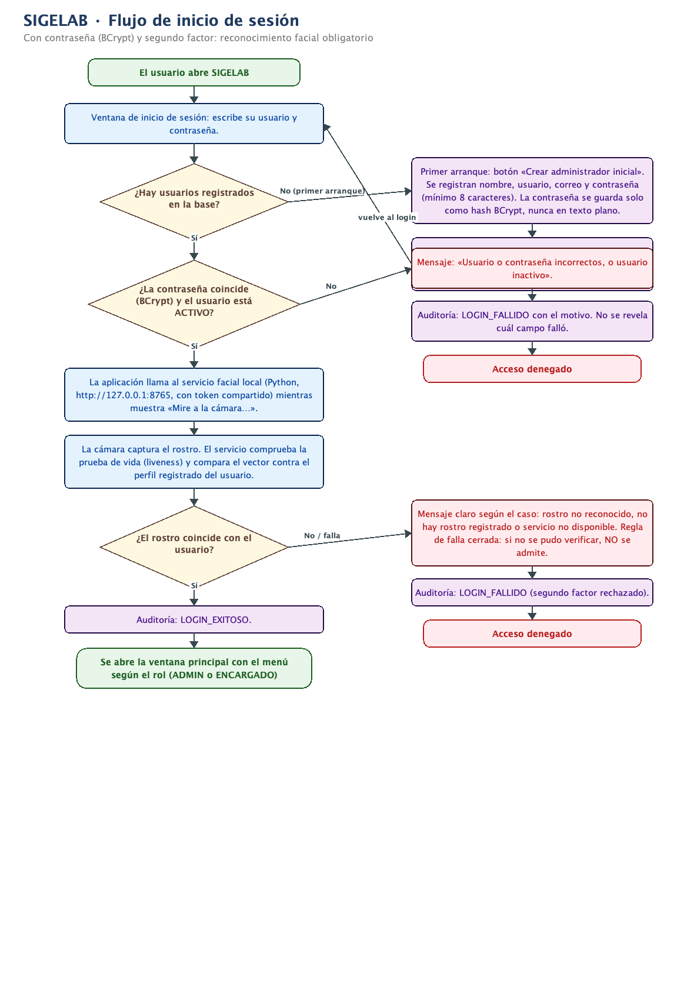

```mermaid
flowchart TD
    A([El usuario abre SIGELAB]) --> B[Ventana de inicio de sesión:<br/>usuario y contraseña]
    B --> C{¿Hay usuarios registrados?}
    C -- "No (primer arranque)" --> D[Crear el primer ADMIN:<br/>la contraseña se guarda como hash BCrypt]
    D --> E[«Registrar mi rostro»:<br/>la cámara guarda el vector facial cifrado]
    E --> B
    C -- Sí --> F{¿Contraseña correcta (BCrypt)<br/>y usuario ACTIVO?}
    F -- No --> G[Mensaje: usuario o contraseña<br/>incorrectos, o usuario inactivo]
    G --> H[(Auditoría: LOGIN_FALLIDO)] --> I([Acceso denegado])
    F -- Sí --> J[Llama al servicio facial local<br/>Python · 127.0.0.1:8765 · «Mire a la cámara…»]
    J --> K[La cámara captura el rostro,<br/>comprueba la prueba de vida (liveness)<br/>y compara con el perfil registrado]
    K --> L{¿El rostro coincide?}
    L -- "No / servicio caído" --> M[Mensaje claro + regla de falla cerrada:<br/>si no se pudo verificar, NO se admite]
    M --> N[(Auditoría: LOGIN_FALLIDO)] --> I
    L -- Sí --> O[(Auditoría: LOGIN_EXITOSO)]
    O --> P([Se abre la ventana principal<br/>con el menú según el rol])
```

---

## 2. Flujo de préstamo

**Qué muestra:** cómo se presta uno o varios equipos. Los equipos se agregan por código o leyendo su QR (el QR **solo identifica**, no cambia estados). Al confirmar, todo ocurre en **una sola transacción**: o se crea el préstamo completo con sus equipos en PRESTADO, o no se crea nada (rollback). Se re-verifica la disponibilidad dentro de la transacción para que dos usuarios no puedan prestar el mismo equipo a la vez.

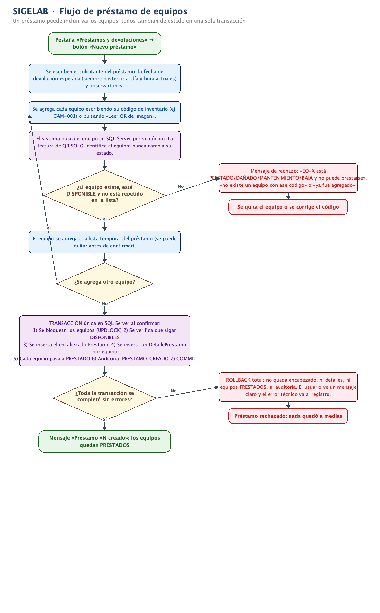

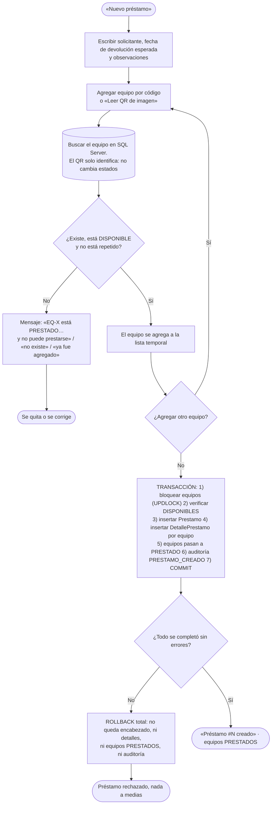

---

## 3. Flujo de devolución

**Qué muestra:** cómo regresan los equipos. Puede ser **parcial** (hoy devuelvo 2 de 3) o completa. Cada equipo se devuelve como BUENO (vuelve a DISPONIBLE) o DANADO (queda DAÑADO y no se presta hasta pasar por mantenimiento). Un equipo nunca se devuelve dos veces y el historial nunca se borra: el préstamo se cierra solo cuando no queda nada pendiente.

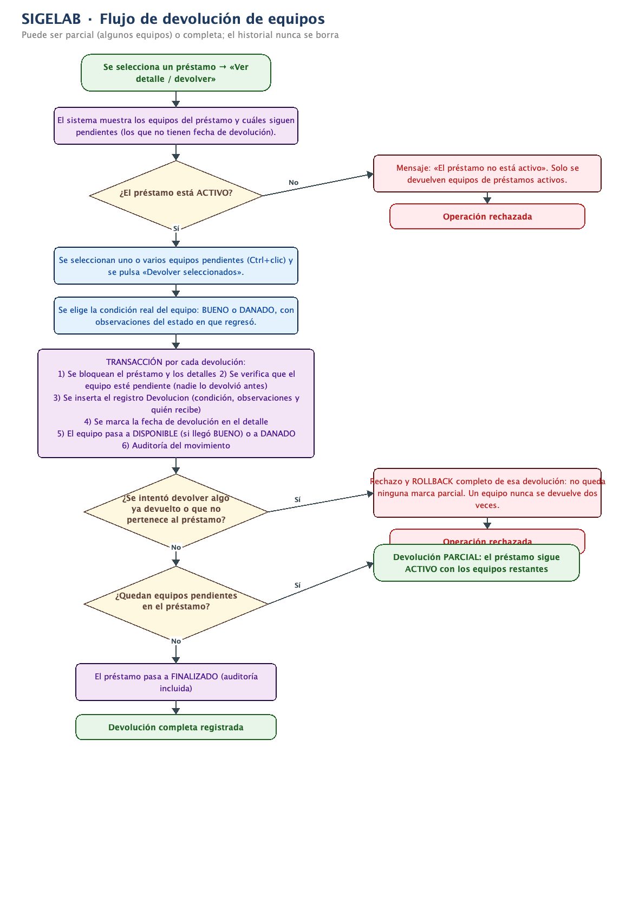

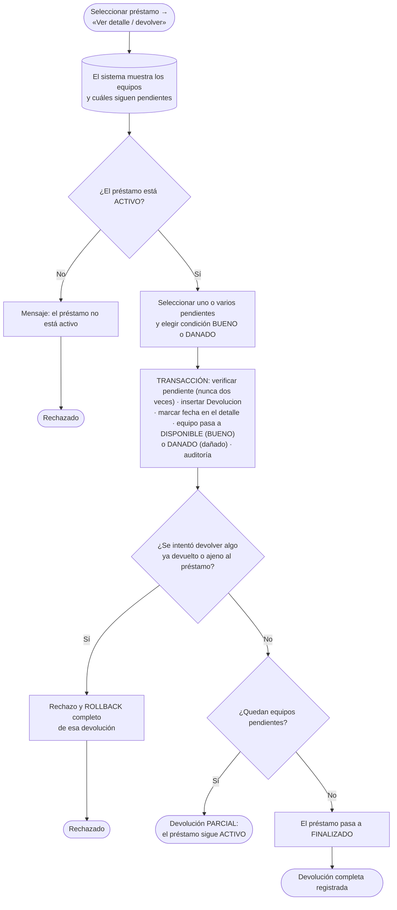

---

## 4. Flujo de mantenimiento

**Qué muestra:** las dos mitades del mantenimiento. **Enviar:** solo equipos DISPONIBLES (preventivo) o DAÑADOS (correctivo) pueden entrar; el equipo queda en MANTENIMIENTO y bloqueado para préstamos. **Finalizar:** el técnico elige el resultado: REPARADO (el equipo vuelve a DISPONIBLE) o NO_REPARABLE (pasa a BAJA y se retira del servicio para siempre).

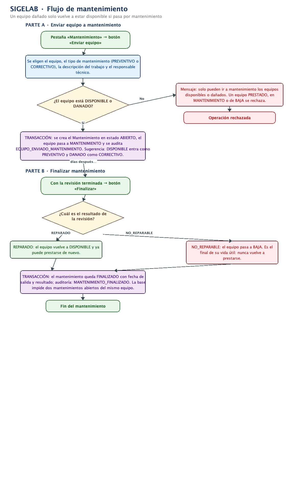

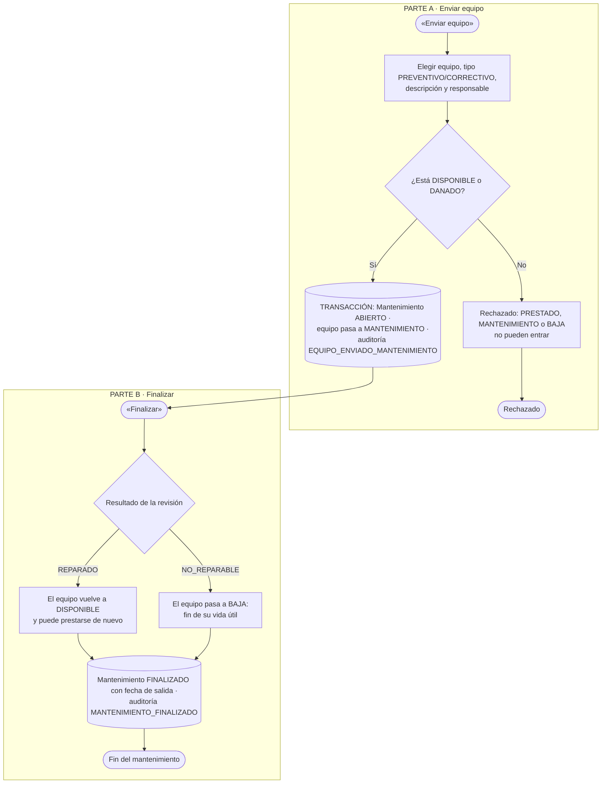

---

## 5. Ciclo de vida del equipo (máquina de estados)

**Qué muestra:** los 5 estados por los que pasa cada equipo y el único camino permitido entre ellos. Es el diagrama clave de la defensa: si se pregunta «¿qué pasa si devuelven dañado un equipo?», la respuesta está aquí. El estado **nunca** se edita a mano en el formulario: solo cambian los procesos.

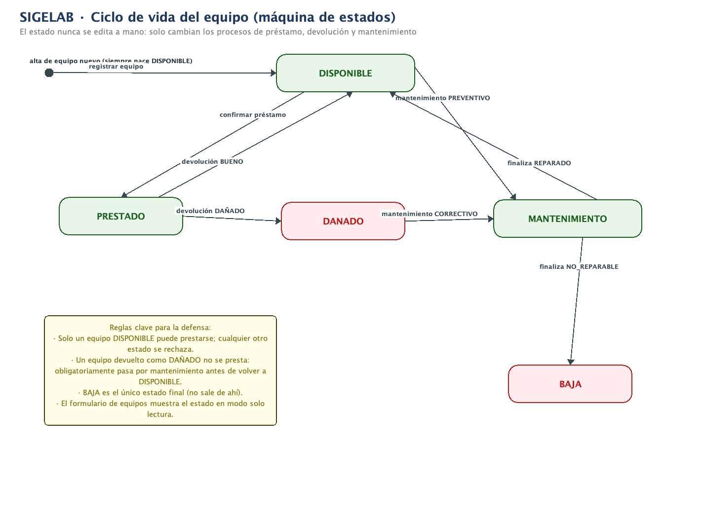

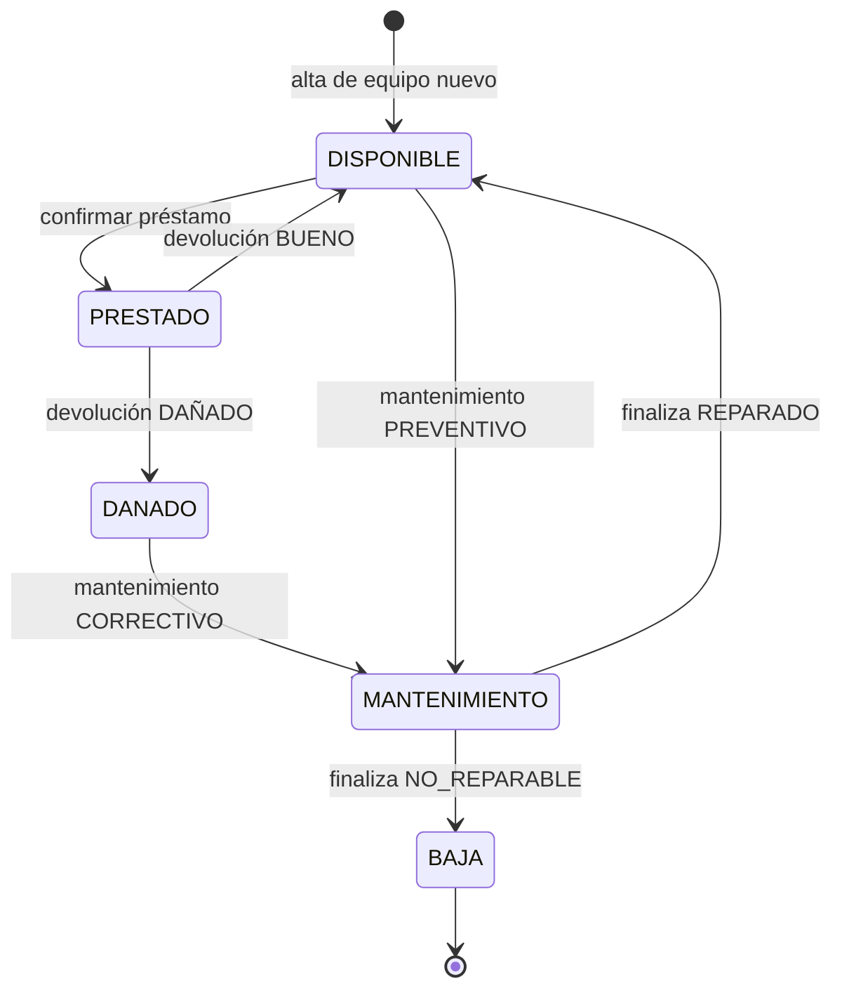

---

## 6. Casos de uso

**Qué muestra:** quién puede hacer qué dentro del sistema. Hay dos roles reales: **ENCARGADO** (operación diaria: equipos, préstamos, devoluciones, mantenimiento, reportes) y **ADMIN**, que hereda todo lo del ENCARGADO y además administra usuarios, rostros, laboratorios, tipos de equipo y consulta la auditoría. El **servicio facial de Python** es un sistema externo que participa en el login y en el registro de rostros.

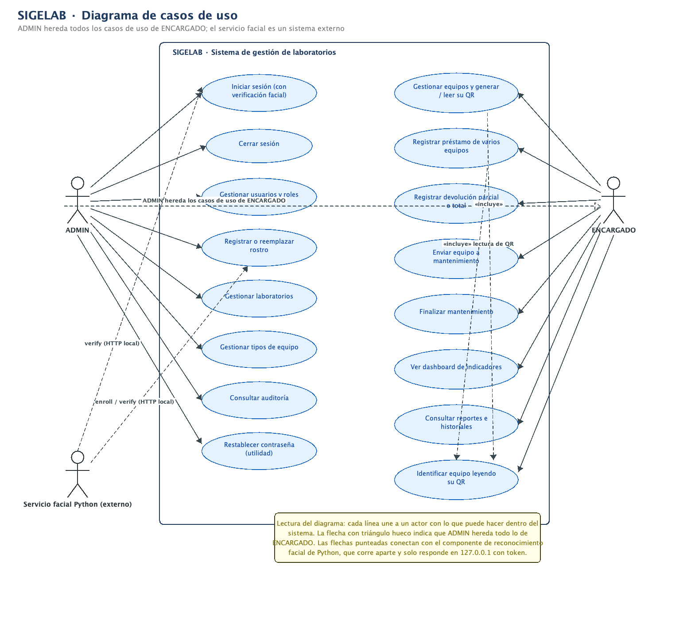

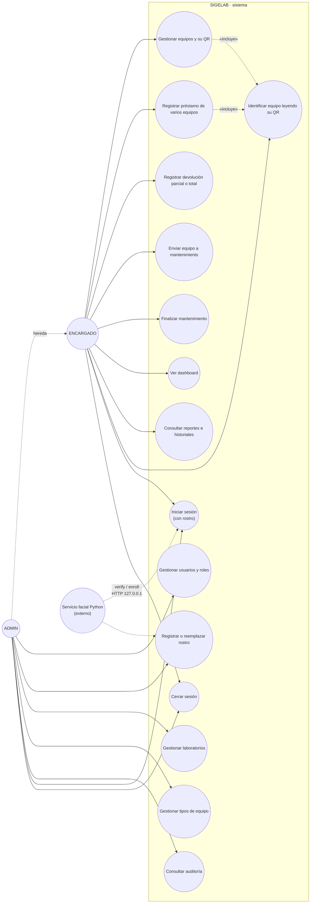

---

## 7. Modelo entidad-relación

**Qué muestra:** las 12 tablas de la base de datos (10 del sistema + 2 del componente facial) y cómo se relacionan. Un detalle importante: `Prestamo` y `Equipo` tienen una relación de muchos a muchos que se resuelve con `DetallePrestamo` (un préstamo trae varios equipos y un equipo aparece en varios préstamos a lo largo del tiempo). Este diagrama coincide exactamente con `database/02_esquema.sql` y `database/05_facial.sql`.

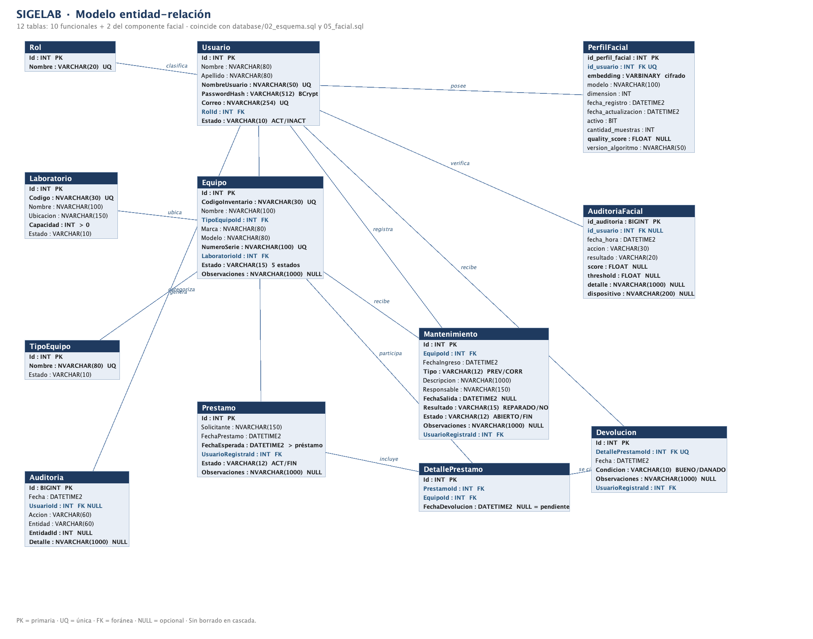

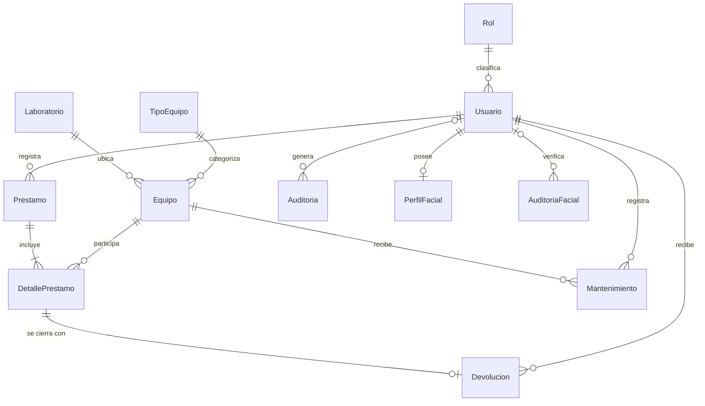

---

## Relación entre diagramas

- El **login** (1) es la única entrada; el menú que se abre depende del rol del **diagrama de casos de uso** (6).
- Un **préstamo** (2) mueve equipos de DISPONIBLE a PRESTADO; la **devolución** (3) los regresa como DISPONIBLE o DAÑADO; el **mantenimiento** (4) es el único camino de DAÑADO de vuelta a DISPONIBLE. Todos los caminos posibles están en la **máquina de estados** (5).
- Cada movimiento de (2), (3) y (4) escribe filas en las tablas del **modelo ER** (7) y queda registrado en `Auditoria`.
