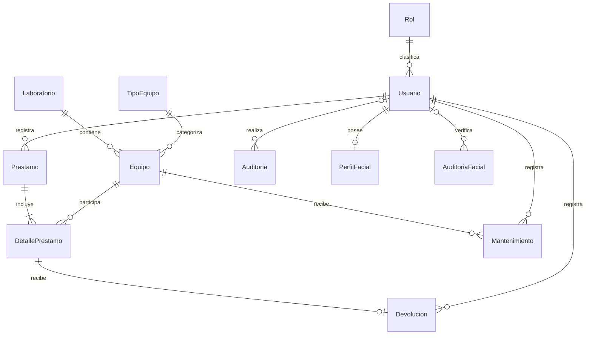

# Modelo de datos y diccionario

Fuente ejecutable: `database/02_esquema.sql` y `database/05_facial.sql`.
Diagrama exportado: `docs/diagramas/modelo-er.png` (regenerable con
`java -Djava.awt.headless=true scripts/GenerarDiagramas.java`).
El diagrama corresponde a las doce tablas del proyecto. Las relaciones no tienen
borrado en cascada; en AuditoriaFacial, eliminar un usuario pone su referencia en NULL.

Prestamo debe contener al menos un detalle por regla de Service; la cardinalidad
mínima no puede garantizarse únicamente con una FK. Un detalle puede no haberse
devuelto; su Devolucion es única cuando existe.

## Diccionario funcional

| Tabla | Campos y tipos principales | Relaciones / restricciones |
|---|---|---|
| Rol | Id INT IDENTITY, Nombre VARCHAR(20) | PK Id, UNIQUE Nombre, ADMIN/ENCARGADO/DOCENTE |
| Usuario | Id INT, Nombre/Apellido NVARCHAR(80), NombreUsuario NVARCHAR(50), PasswordHash VARCHAR(512), Correo NVARCHAR(254), RolId INT, Estado VARCHAR(10) | Usuario único; FK Rol; ACTIVO/INACTIVO; hash obligatorio |
| Laboratorio | Id INT, Codigo NVARCHAR(30), Nombre NVARCHAR(100), Ubicacion NVARCHAR(150), Capacidad INT, Estado VARCHAR(10) | Código único, capacidad positiva, ACTIVO/INACTIVO |
| TipoEquipo | Id INT, Nombre NVARCHAR(80), Estado VARCHAR(10) | Nombre único, ACTIVO/INACTIVO |
| Equipo | Id INT, CodigoInventario NVARCHAR(30), Nombre NVARCHAR(100), TipoEquipoId INT, Marca/Modelo NVARCHAR(80), NumeroSerie NVARCHAR(100) NULL, LaboratorioId INT, Estado VARCHAR(15), Observaciones NVARCHAR(1000) NULL | Inventario único, FK tipo/laboratorio, cinco estados |
| Prestamo | Id INT, Solicitante NVARCHAR(150), FechaPrestamo/FechaEsperada DATETIME2, UsuarioRegistraId INT, Estado VARCHAR(12), Observaciones NVARCHAR(1000) NULL | FK usuario, fecha esperada posterior, ACTIVO/FINALIZADO |
| DetallePrestamo | Id INT, PrestamoId INT, EquipoId INT, FechaDevolucion DATETIME2 NULL | FK préstamo/equipo; UNIQUE préstamo+equipo; un pendiente por equipo |
| Devolucion | Id INT, DetallePrestamoId INT, Fecha DATETIME2, Condicion VARCHAR(10), Observaciones NVARCHAR(1000) NULL, UsuarioRegistraId INT | Detalle único, FK usuario; BUENO/DANADO |
| Mantenimiento | Id INT, EquipoId INT, FechaIngreso DATETIME2, Tipo VARCHAR(12), Descripcion NVARCHAR(1000), Responsable NVARCHAR(150), FechaSalida DATETIME2 NULL, Resultado VARCHAR(15) NULL, Estado VARCHAR(12), Observaciones NVARCHAR(1000) NULL, UsuarioRegistraId INT | FK equipo/usuario; PREVENTIVO/CORRECTIVO; un abierto por equipo; cierre coherente |
| Auditoria | Id BIGINT, Fecha DATETIME2, UsuarioId INT NULL, Accion/Entidad VARCHAR(60), EntidadId INT NULL, Detalle NVARCHAR(1000) NULL | FK usuario; ID de entidad permite auditar distintos módulos |

Todos los Id anteriores son IDENTITY y PRIMARY KEY. Los campos sin indicación NULL
son NOT NULL. Los estados predeterminados se especifican en el SQL.

## Diccionario facial

| Tabla | Campos | Restricciones |
|---|---|---|
| PerfilFacial | id_perfil_facial INT IDENTITY, id_usuario INT, embedding VARBINARY(MAX), modelo NVARCHAR(100), dimension INT, fecha_registro/fecha_actualizacion DATETIME2(0), activo BIT, cantidad_muestras INT, quality_score FLOAT NULL, version_algoritmo NVARCHAR(50) | PK; usuario único y FK Usuario.Id; dimensión/muestras positivas |
| AuditoriaFacial | id_auditoria BIGINT IDENTITY, id_usuario INT NULL, fecha_hora DATETIME2(0), accion VARCHAR(30), resultado VARCHAR(20), score/threshold FLOAT NULL, detalle NVARCHAR(1000) NULL, dispositivo NVARCHAR(200) NULL | PK; FK Usuario.Id; acciones limitadas por CHECK |

PerfilFacial guarda un vector cifrado, no la imagen. AuditoriaFacial no contiene
el vector ni la clave. La clave vive en la configuración local fuera de Git.

## Estados e integridad

| Acción | Estado anterior | Estado posterior |
|---|---|---|
| Crear equipo | No existe | DISPONIBLE |
| Confirmar préstamo | DISPONIBLE | PRESTADO |
| Devolver bueno | PRESTADO | DISPONIBLE |
| Devolver dañado | PRESTADO | DANADO |
| Abrir mantenimiento | DISPONIBLE o DANADO | MANTENIMIENTO |
| Cerrar reparado | MANTENIMIENTO | DISPONIBLE |
| Cerrar no reparable | MANTENIMIENTO | BAJA |

FechaDevolucion en detalle identifica pendientes; Devolucion almacena el evento y
la condición. Ambas se actualizan juntas dentro de una transacción. Los procesos
Java son responsables de sincronizar estado de equipo y detalle; no se debe editar
manualmente estas tablas durante la operación del sistema.

Los índices filtrados son específicos de SQL Server. No deben sustituirse por una
base en memoria para la demostración final. Roles DOCENTE y campos extra pueden
extenderse, pero no se implementan procesos de asistencia del proyecto de referencia.
